# n8n-hubspot-custom-object-multi-level-association-validator

> Data integrity guard that audits complex multi-directional HubSpot custom object associations (e.g., Parent → Child → Asset), flagging orphaned records and broken links.

   

Every Sunday at 02:00 UTC the workflow does the following:
1. Confirms that the configured association type IDs exist (schema preflight).
2. Pages through every Parent, Child and Asset custom object record.
3. Reads each association direction with the CRM v4 batch API (child → parent, parent → child, asset → child, child → asset).
4. Audits the three-level hierarchy for:
   - orphaned records;
   - dangling links to deleted IDs;
   - broken chains;
   - cardinality violations;
   - association-type mismatches;
   - asymmetric links.
5. Plans guarded remediation: re-link orphans from a unique hint match, archive verified dangling links, and flag records with `integrity_status`.
6. Posts a RevOps Slack Block Kit digest with deep links to every affected record.

**Safe by default:** imported as-is, the workflow audits a synthetic fixture, makes **zero** external API calls, changes **nothing** in HubSpot and sends **nothing** to Slack.

---

## Table of contents

1. [Repository layout](#repository-layout)
2. [Architecture overview](#architecture-overview)
3. [Prerequisites and HubSpot scopes](#prerequisites-and-hubspot-scopes)
4. [5-minute sandbox quick start](#5-minute-sandbox-quick-start)
5. [Step-by-step import and configuration](#step-by-step-import-and-configuration)
6. [Environment variables](#environment-variables)
7. [Required HubSpot properties](#required-hubspot-properties)
8. [Validation algorithm](#validation-algorithm)
9. [Orphan detection logic](#orphan-detection-logic)
10. [Severity and alerting](#severity-and-alerting)
11. [Remediation and the mutation guard](#remediation-and-the-mutation-guard)
12. [Slack alert format](#slack-alert-format)
13. [Offline simulator](#offline-simulator)
14. [Safety matrix](#safety-matrix)
15. [Data protection and compliance checklist](#data-protection-and-compliance-checklist)
16. [Troubleshooting](#troubleshooting)
17. [Disclaimer and license](#️-disclaimer--liability-limitation)

---

## Repository layout

```text
n8n-hubspot-custom-object-multi-level-association-validator/
├── workflow.json                                   # Import into n8n (28 nodes, inactive on import)
├── README.md                                       # This file
├── DISCLAIMER.md                                   # Liability limitation
├── LICENSE                                         # MIT © 2026 DH Robin (dhRobin Systems)
├── .env.example                                    # Placeholder environment template
├── .gitignore
├── sample-payloads/
│   └── hubspot-association-hierarchy-fixture.json  # Synthetic Parent → Child → Asset graph (valid, orphaned, broken)
└── scripts/
    └── simulate-sandbox-run.js                     # Offline runner for every Code node in workflow.json
```

---

## Architecture overview

```mermaid
flowchart LR
    subgraph Triggers
        A1[Weekly Schedule Trigger<br/>cron 0 2 * * 0 · UTC]
        A2[Manual Test Trigger]
    end
    A1 --> B[Config & Safety Gate<br/>reads $env · derives gates]
    A2 --> B
    B --> C{Route:<br/>Sandbox or Live?}

    C -- sandbox --> D[Load Sandbox Fixture<br/>synthetic graph]
    C -- live --> E[Build Live Fetch Plan]
    E --> F[[HubSpot: Read Schema<br/>Definitions · v3 schemas]]
    F --> G1[[Search Parent Records<br/>paginated]]
    G1 --> G2[[Search Child Records<br/>paginated]]
    G2 --> G3[[Search Asset Records<br/>paginated]]
    G3 --> H[Build Association<br/>Read Batches]
    H --> H2{Any reads?}
    H2 -- yes --> I[[HubSpot: Batch Read<br/>Associations v4 · 4 directions]]
    I --> J[Assemble Live<br/>Association Graph]
    H2 -- no --> J

    D --> K[Association Integrity &<br/>Orphan Detection Engine]
    J --> K
    K --> L[Build Remediation Batches]
    L --> M{Gate: Live CRM<br/>Mutation Allowed?}
    M -- yes --> N[[HubSpot: Execute<br/>Remediation Batch]]
    N --> O[Collect Remediation Results]
    M -- no --> P[Dry-Run Remediation Preview]
    O --> Q[RevOps Slack Block Kit Builder]
    P --> Q
    Q --> R{Gate: Slack<br/>Send Allowed?}
    R -- yes --> S[[Slack: Post RevOps Alert]]
    R -- no --> T[Slack Alert Skipped]
    S --> U[Execution Summary & Audit]
    T --> U
    U --> V{Gate: Ops<br/>Alert Needed?}
    V -- yes --> W[[Ops: Post Failure Alert]]

    classDef ext fill:#fff4e6,stroke:#ff7a59;
    classDef gate fill:#eef6ff,stroke:#3b82f6;
    class F,G1,G2,G3,I,N,S,W ext;
    class C,H2,M,R,V gate;
```



Double-bordered nodes are the only nodes that make network calls. The read-only ones run only when `SANDBOX_MODE=false`. The mutating ones (`Execute Remediation Batch`, Slack, ops) each sit behind a gate that is **closed by default**.

| # | Node | Type | Purpose |
|---|------|------|---------|
| 1 | Weekly Schedule Trigger | Schedule | Cron `0 2 * * 0` (Sunday 02:00, workflow timezone UTC) |
| 2 | Manual Test Trigger | Manual | Click-to-run for testing |
| 3 | Config & Safety Gate | Code | Reads env vars and applies safe defaults. Defines the hierarchy and association type IDs, then derives `allowHubspotMutations`, `allowSlackSend` and `allowOpsAlert`. Never copies secret values. |
| 4 | Route: Sandbox or Live? | IF | `sandboxMode === true` → fixture |
| 5 | Load Sandbox Fixture | Code | Emits the embedded synthetic graph (mirrors `sample-payloads/`) |
| 6 | Build Live Fetch Plan | Code | One item per level for the schema preflight |
| 7 | HubSpot: Read Schema Definitions | HTTP GET | `/crm/v3/schemas/{objectType}`: confirms the configured association type IDs exist |
| 8–10 | HubSpot: Search Parent / Child / Asset Records | HTTP POST | `/crm/v3/objects/{type}/search`, `limit 100`, body `after` pagination, **Execute Once** |
| 11 | Build Association Read Batches | Code | v4 `batch/read` requests for all four directions, chunked by `ASSOCIATION_BATCH_SIZE` |
| 12 | Gate: Any Association Reads? | IF | Skips the HTTP call when there are no records |
| 13 | HubSpot: Batch Read Associations (v4) | HTTP POST | `/crm/v4/associations/{from}/{to}/batch/read` |
| 14 | Assemble Live Association Graph | Code | Rebuilds the same graph shape as the fixture. Records truncation and fetch errors. |
| 15 | Association Integrity & Orphan Detection Engine | Code | All checks, record statuses, remediation plan, mutation guard |
| 16 | Build Remediation Batches | Code | Orders create → archive → flag, chunked ≤ 100. Always emits ≥ 1 item. |
| 17 | Gate: Live CRM Mutation Allowed? | IF | `allowWrite === true` |
| 18 | HubSpot: Execute Remediation Batch | HTTP POST | **Association batch audit/log node:** v4 `batch/create`, v4 `batch/archive`, v3 `batch/update` (`integrity_status`) |
| 19 | Collect Remediation Results | Code | Per-action success and failure accounting |
| 20 | Dry-Run Remediation Preview | Code | The exact endpoints, record counts and sample body that *would* run |
| 21 | RevOps Slack Block Kit Builder | Code | Digest with record deep links (always built for preview) |
| 22 | Gate: Slack Send Allowed? | IF | `allowSend === true` |
| 23 | Slack: Post RevOps Alert | HTTP POST | `{{ $env.SLACK_ALERT_WEBHOOK_URL }}` |
| 24 | Slack Alert Skipped | Code | Records the skip reason |
| 25 | Execution Summary & Audit | Code | Secret-free audit record + checksum. Decides on the ops alert. |
| 26 | Gate: Ops Alert Needed? | IF | `needsOpsAlert === true` |
| 27 | Ops: Post Failure Alert | HTTP POST | `{{ $env.ALERT_WEBHOOK_URL }}` |
| — | Safety Notes | Sticky note | On-canvas reminder of the gates |

HTTP node behaviour:
- No n8n credentials are stored. Every call authenticates with `Authorization: Bearer {{ $env.HUBSPOT_ACCESS_TOKEN }}`.
- Failed calls retry 3× with a 3 s back-off.
- `onError: continueRegularOutput` means failures are reported rather than crashing the run.
- Requests are sent one at a time with a delay, to respect HubSpot rate limits.

---

## Prerequisites and HubSpot scopes

| Requirement | Notes |
|---|---|
| n8n (self-hosted) | 1.x or newer: Code node v2, IF node v2.2, HTTP Request node v4.2 with pagination. n8n Cloud does not allow custom environment variables; on Cloud, replace `$env.X` with `$vars.X` (Variables) or n8n credentials. |
| `$env` access | Set `N8N_BLOCK_ENV_ACCESS_IN_NODE=false` on the instance. If access is blocked, the Config node falls back to sandbox + dry-run automatically. |
| Node.js ≥ 18 | Only for the offline simulator. No npm dependencies. |
| HubSpot | A **developer test account or sandbox** for staging, and a plan with custom objects (Enterprise) for production. |
| Custom objects | Three distinct custom object types (Parent, Child, Asset) with association definitions Parent ↔ Child and Child ↔ Asset. |

**HubSpot private app scopes:**

| Scope | Used by | Needed when |
|---|---|---|
| `crm.schemas.custom.read` | `Read Schema Definitions` (preflight) | Always in live mode |
| `crm.objects.custom.read` | Record searches, v4 association `batch/read` | Always in live mode |
| `crm.objects.custom.write` | v4 association `batch/create` / `batch/archive`, v3 `batch/update` of `integrity_status` | Only when remediation is enabled. Omit it for audit-only deployments. |

Creating the four `integrity_*` properties once ([below](#required-hubspot-properties)) needs `crm.schemas.custom.write`. Use a separate setup token for that, or create the properties in the UI.

---

## 5-minute sandbox quick start

No accounts, tokens or network needed.

```bash
node scripts/simulate-sandbox-run.js
```

Expected: `All 35 checks passed.` The synthetic fixture exercises every rule:

| Synthetic record | Case | Expected finding → remediation |
|---|---|---|
| ChildProject A, B · AssetUnit X, Y | Valid chain to ParentCorp Inc | none |
| ChildProject C | No parent link, `parent_external_id = PAR-002` | `orphan_child` → **re-link to ParentHoldings Ltd** (unique hint match) |
| ChildProject D | No parent link, no hint | `orphan_child` → manual review |
| ChildProject G | Hint `PAR-404` matches nothing | `orphan_child` → manual review |
| ChildProject H | Only link points to deleted parent `9100999` | `dangling_association` → archive · `orphan_child` → manual |
| ParentHoldings Ltd | Link to deleted child `9200998` | `dangling_association` → archive |
| ChildProject E | Linked to two parents (max 1) | `cardinality_violation` → manual review |
| ChildProject F | Parent link uses type `999`, not `901` | `association_label_mismatch` → add the expected type |
| AssetUnit Z | No child link, `child_external_id = CHD-001` | `orphan_asset` → **re-link to ChildProject A** |
| AssetUnit W | Only link points to deleted child `9200999` | `dangling_association` → archive · `orphan_asset` |
| AssetUnit V | Linked only to orphaned ChildProject D | `broken_chain` → resolves when D is re-parented |
| AssetUnit U | Seen in asset → child read but not child → asset | `asymmetric_association` → manual review |
| EmptyShell Group | Parent with no children | `empty_parent` (informational) |
| AssetUnit T | Healthy now, flagged `orphaned` last run | flag cleared → `integrity_status = ok` |

Then:

```bash
# Import (UI: Workflows → Import from File → workflow.json) or CLI:
n8n import:workflow --input=workflow.json
# Open the workflow and click "Test workflow".
# Inspect "Association Integrity & Orphan Detection Engine" and "Dry-Run Remediation Preview".
```

---

## Step-by-step import and configuration

1. **Import** `workflow.json`. It arrives **inactive** with no credentials attached.
2. **Sandbox test:** run the Manual Test Trigger. `Config & Safety Gate` should show `modeLabel: "SANDBOX"` with every `allow*` gate `false`.
3. **Map your hierarchy.** Set `HUBSPOT_PARENT_OBJECT_TYPE`, `HUBSPOT_CHILD_OBJECT_TYPE` and `HUBSPOT_ASSET_OBJECT_TYPE` (fully qualified name `p<portal>_<name>` or `2-xxxxx`), and the matching `*_OBJECT_TYPE_ID` (`2-xxxxx`, used for record links).
4. **Find association type IDs** in your staging portal:
   ```bash
   curl -s https://api.hubapi.com/crm/v4/associations/$CHILD_TYPE/$PARENT_TYPE/labels \
     -H "Authorization: Bearer $HUBSPOT_ACCESS_TOKEN"
   ```
   Set `PARENT_CHILD_UP_TYPE_ID` (child → parent) and `PARENT_CHILD_DOWN_TYPE_ID` (parent → child). Repeat for asset ↔ child (`CHILD_ASSET_UP_TYPE_ID`, `CHILD_ASSET_DOWN_TYPE_ID`). Use `ASSOCIATION_CATEGORY=HUBSPOT_DEFINED` if you rely on the default unlabeled type.
5. **Create the integrity properties** on all three objects ([below](#required-hubspot-properties)).
6. **Create a private app** with `crm.objects.custom.read` + `crm.schemas.custom.read`, plus `crm.objects.custom.write` only if you will remediate. Store the token in `HUBSPOT_ACCESS_TOKEN` on the n8n host (environment or secrets manager, never in the workflow).
7. **Live dry run:** `SANDBOX_MODE=false`, keep `DRY_RUN=true`. Restart n8n. This runs only reads. Confirm `modeLabel: "LIVE-DRY-RUN"`, `schemaCheck.ok: true`, no `fetch_errors` and no truncation. Review `Dry-Run Remediation Preview`.
8. **Enable flagging only:** `DRY_RUN=false`, `HUBSPOT_MUTATIONS_ENABLED=true`, `REMEDIATION_ACTIONS=flag_records`. Run, then build a HubSpot view on `integrity_status ≠ ok`.
9. **Optionally enable repairs**, one at a time, after reviewing a preview:
   - `REMEDIATION_ACTIONS=flag_records,archive_dangling_association`
   - then `…,create_missing_association`
   Keep `MAX_MUTATIONS_PER_RUN` low (e.g. 25) for the first live runs.
10. **Alerts:** `SEND_SLACK_ALERTS=true` + `SLACK_ALERT_WEBHOOK_URL`. Optionally `SEND_OPS_ALERTS=true` + `ALERT_WEBHOOK_URL`.
11. **Activate** the workflow. It runs Sundays 02:00 UTC.

> **Promotion rule:** change one flag at a time and re-run the simulator after any workflow edit.

---

## Environment variables

| Variable | Default when unset | Description |
|---|---|---|
| `SANDBOX_MODE` | `true` | Synthetic fixture; no HubSpot calls. Forced back to `true` if the token is missing or object types are not distinct. |
| `DRY_RUN` | `true` | Blocks every mutation (HubSpot, Slack, ops). Live reads still run when sandbox is off. |
| `HUBSPOT_MUTATIONS_ENABLED` | `false` | Master opt-in for HubSpot writes. |
| `SEND_SLACK_ALERTS` / `SEND_OPS_ALERTS` | `false` | Opt-in for Slack / ops webhook posts. |
| `HUBSPOT_ACCESS_TOKEN` | — | Private app token. **Secret.** |
| `HUBSPOT_PORTAL_ID` | `99000001` | Used in record deep links and the audit record. |
| `HUBSPOT_APP_BASE_URL` | `https://app.hubspot.com` | Use `https://app-eu1.hubspot.com` for EU data-centre portals. |
| `HUBSPOT_PARENT_OBJECT_TYPE` / `_ID` | `p99000001_parent_account` / `2-99000101` | Parent custom object |
| `HUBSPOT_CHILD_OBJECT_TYPE` / `_ID` | `p99000001_child_project` / `2-99000102` | Child custom object |
| `HUBSPOT_ASSET_OBJECT_TYPE` / `_ID` | `p99000001_asset_unit` / `2-99000103` | Asset custom object |
| `PARENT_LABEL` / `CHILD_LABEL` / `ASSET_LABEL` | `Parent` / `Child` / `Asset` | Display names in alerts |
| `PARENT_CHILD_UP_TYPE_ID` / `_DOWN_TYPE_ID` | `901` / `902` | Association type IDs child → parent / parent → child (mock) |
| `CHILD_ASSET_UP_TYPE_ID` / `_DOWN_TYPE_ID` | `903` / `904` | Association type IDs asset → child / child → asset (mock) |
| `ASSOCIATION_CATEGORY` | `USER_DEFINED` | Category used when creating associations |
| `MAX_PARENTS_PER_CHILD` / `MAX_CHILDREN_PER_ASSET` | `1` / `1` | Cardinality limits |
| `REQUIRE_PARENT_FOR_CHILD` / `REQUIRE_CHILD_FOR_ASSET` | `true` / `true` | Whether a missing upper link counts as an orphan |
| `STRICT_ASSOCIATION_TYPES` | `true` | Flag links that lack the expected type ID |
| `CHECK_BIDIRECTIONAL_ASSOCIATIONS` | `true` | Read both directions and flag asymmetric links |
| `FLAG_EMPTY_PARENTS` | `true` | Report parents with no children (low severity) |
| `RECORD_NAME_PROPERTY` / `RECORD_KEY_PROPERTY` | `name` / `external_id` | Display name and unique key properties |
| `CHILD_PARENT_HINT_PROPERTY` / `ASSET_CHILD_HINT_PROPERTY` | `parent_external_id` / `child_external_id` | Hint properties used to re-link orphans |
| `REMEDIATION_ACTIONS` | `flag_records` | Comma list: `create_missing_association`, `archive_dangling_association`, `flag_records` |
| `MAX_MUTATIONS_PER_RUN` | `100` | Circuit breaker: if more changes are planned, **all** remediation is blocked |
| `MUTATION_ABORT_ORPHAN_RATE_PCT` | `50` | Circuit breaker: an orphan rate above this signals a fetch/config problem; all remediation is blocked |
| `MUTATION_BATCH_SIZE` | `100` | Inputs per HubSpot batch call (≤ 100) |
| `SEARCH_MAX_PAGES` | `100` | Pages × 100 records per level (HubSpot search returns at most 10,000) |
| `ASSOCIATION_BATCH_SIZE` | `100` | IDs per v4 `batch/read` request |
| `ORPHAN_RATE_ALERT_THRESHOLD_PCT` | `5` | Orphan rate at or above which run severity becomes **critical** |
| `ALERT_MIN_SEVERITY` | `medium` | Minimum issue severity that triggers Slack |
| `SLACK_ALERT_WEBHOOK_URL` | — | Slack incoming webhook. **Secret.** |
| `ALERT_WEBHOOK_URL` | — | Ops JSON webhook. **Secret.** |
| `RUN_TIMESTAMP_OVERRIDE` | — | ISO timestamp to pin the run clock (tests) |
| `N8N_BLOCK_ENV_ACCESS_IN_NODE` | instance default | Must be `false` for this workflow to read the variables above |

Unrecognised flag values (e.g. `DRY_RUN=maybe`) fall back to the **safe** default and are recorded as warnings.

### Sample `.env`

```dotenv
# Safety flags
SANDBOX_MODE=true
DRY_RUN=true
HUBSPOT_MUTATIONS_ENABLED=false
SEND_SLACK_ALERTS=false
SEND_OPS_ALERTS=false

# HubSpot
HUBSPOT_ACCESS_TOKEN=replace-with-hubspot-private-app-token
HUBSPOT_PORTAL_ID=99000001

# Hierarchy (placeholders)
HUBSPOT_PARENT_OBJECT_TYPE=p99000001_parent_account
HUBSPOT_PARENT_OBJECT_TYPE_ID=2-99000101
HUBSPOT_CHILD_OBJECT_TYPE=p99000001_child_project
HUBSPOT_CHILD_OBJECT_TYPE_ID=2-99000102
HUBSPOT_ASSET_OBJECT_TYPE=p99000001_asset_unit
HUBSPOT_ASSET_OBJECT_TYPE_ID=2-99000103

# Association type IDs (mock)
PARENT_CHILD_UP_TYPE_ID=901
PARENT_CHILD_DOWN_TYPE_ID=902
CHILD_ASSET_UP_TYPE_ID=903
CHILD_ASSET_DOWN_TYPE_ID=904

# Remediation
REMEDIATION_ACTIONS=flag_records
MAX_MUTATIONS_PER_RUN=100
MUTATION_ABORT_ORPHAN_RATE_PCT=50

# Alerts
ORPHAN_RATE_ALERT_THRESHOLD_PCT=5
ALERT_MIN_SEVERITY=medium
SLACK_ALERT_WEBHOOK_URL=https://hooks.example.com/slack/crm-integrity-alerts
ALERT_WEBHOOK_URL=https://alerts.example.com/ops/association-validator

# n8n instance
N8N_BLOCK_ENV_ACCESS_IN_NODE=false
```

See `.env.example` for every variable. For Docker, use `docker run --env-file .env …` or `env_file:` in Compose.

---

## Required HubSpot properties

The workflow reads `name`, `external_id`, the two hint properties and `integrity_status`. The `flag_records` action writes four audit properties. Create them on **each** of the three objects (one-time, needs `crm.schemas.custom.write`):

```json
POST https://api.hubapi.com/crm/v3/properties/{objectType}/batch/create
{
  "inputs": [
    { "name": "integrity_status", "label": "Integrity Status", "type": "enumeration", "fieldType": "select", "groupName": "association_integrity",
      "options": [
        { "label": "OK", "value": "ok", "displayOrder": 0 },
        { "label": "Orphaned", "value": "orphaned", "displayOrder": 1 },
        { "label": "Broken link", "value": "broken_link", "displayOrder": 2 },
        { "label": "Broken chain", "value": "broken_chain", "displayOrder": 3 },
        { "label": "Needs review", "value": "needs_review", "displayOrder": 4 }
      ] },
    { "name": "integrity_issue_codes", "label": "Integrity Issue Codes", "type": "string", "fieldType": "text", "groupName": "association_integrity" },
    { "name": "integrity_last_checked", "label": "Integrity Last Checked", "type": "date", "fieldType": "date", "groupName": "association_integrity" },
    { "name": "integrity_run_id", "label": "Integrity Run ID", "type": "string", "fieldType": "text", "groupName": "association_integrity" }
  ]
}
```

Create the `association_integrity` property group first (`POST /crm/v3/properties/{objectType}/groups`), or change `groupName` to an existing group. Only records whose status **changes** are written. Clean records that were never flagged are not touched, so first runs stay small.

---

## Validation algorithm

1. **Schema preflight.** For each relation, check that the configured up and down type IDs appear in `GET /crm/v3/schemas/{type}` → `associations[].id`. A missing ID raises `association_definition_missing` (critical) and blocks association creation.
2. **Fetch.**
   - Search each level (100 per page, body `after` pagination, ascending `hs_object_id`).
   - A last page that still has `paging.next`, or `total > fetched`, marks that level **truncated**.
   - Read associations for all four directions with v4 `batch/read`. IDs with no associations appear under `errors` (`NO_ASSOCIATIONS_FOUND`); that is treated as data, not failure.
3. **Index.** Build a record map per level (excluding archived records) and a `key → records` index from `RECORD_KEY_PROPERTY`.
4. **Edge merge.** For each relation (Parent ↔ Child, Child ↔ Asset), merge both reads into one edge per `(lower, upper)` pair. Each edge tracks `up` / `down` presence and the type IDs seen in each direction.
5. **Per edge:**
   - **Dangling:** one endpoint is not in the fetched records, meaning it was deleted or archived. The verdict is *verified* only if the missing side's search was neither truncated nor failed. Verified → plan `archive_dangling_association`; unverified → report only.
   - **Asymmetric:** both endpoints exist and both directions were read, but the edge appears in only one.
   - **Label mismatch** (`STRICT_ASSOCIATION_TYPES`): the edge lacks the expected type ID. The planned fix adds the expected type; it never removes the existing one.
6. **Per lower record:** orphan and cardinality checks ([next section](#orphan-detection-logic)).
7. **Per parent:** `empty_parent` if no valid child links. Skipped when the child search was truncated.
8. **Chain check:** an asset whose every valid child is an orphan gets `broken_chain`, because it cannot reach any parent.
9. **Record status:** `orphaned` > `broken_link` > `broken_chain` > `needs_review` > `ok`. Compare with the stored `integrity_status` and plan a flag update only on change. Stale flags are cleared to `ok`.
10. **Plan and guard:** group planned changes into HubSpot batch payloads and apply the [mutation guard](#remediation-and-the-mutation-guard).

---

## Orphan detection logic

For each Child (relation Parent ↔ Child) and each Asset (relation Child ↔ Asset):

```text
valid_uppers = { upper | edge(lower, upper) exists in either direction AND upper exists }

if up-direction could not be read            → audit_incomplete (critical), skip, block mutations
if valid_uppers = ∅ and link target unverified → skip (target may exist beyond a truncated search)
if valid_uppers = ∅ and REQUIRE_* = true     → orphan_<level> (high)
     hint = record[HINT_PROPERTY]
     matches = upper records where RECORD_KEY_PROPERTY == hint (case-insensitive)
     |matches| = 1 → plan create_missing_association(lower → match, UP_TYPE_ID)
     |matches| > 1 → manual_review ("ambiguous hint")
     |matches| = 0 → manual_review ("hint unmatched")
     no hint       → manual_review
if |valid_uppers| > MAX_*                    → cardinality_violation (medium, never auto-fixed)
```

Key rules:
- **Dangling links don't count as parents.** A child whose only link points to a deleted parent is both `dangling_association` and `orphan_child`.
- **Re-linking needs an exact, unique match.** It never relies on name similarity or a guess.
- **The validator never removes valid associations.** Cardinality violations always go to a person.

---

## Severity and alerting

| Issue code | Severity | Auto-remediation |
|---|---|---|
| `audit_incomplete`, `association_definition_missing` | **critical** | none (blocks mutations) |
| `orphan_child`, `orphan_asset` | **high** | `create_missing_association` on a unique hint match |
| `dangling_association` | **high** | `archive_dangling_association` when verified |
| `broken_chain` | **high** | none (fix the parent-less child) |
| `cardinality_violation`, `asymmetric_association` | medium | none |
| `association_label_mismatch` | medium | `create_missing_association` (adds the expected type) |
| `empty_parent` | low | none |

- **Run severity** is the highest issue severity, escalated to **critical** when `orphan rate ≥ ORPHAN_RATE_ALERT_THRESHOLD_PCT`.
- **Orphan rate** is orphaned children and assets divided by all children and assets.
- **Integrity score** is healthy records divided by all records.
- **Slack fires** when any issue is at or above `ALERT_MIN_SEVERITY`, or the run is critical.

---

## Remediation and the mutation guard

| Action | HubSpot call | Scope |
|---|---|---|
| `create_missing_association` | `POST /crm/v4/associations/{from}/{to}/batch/create` with `types: [{associationCategory, associationTypeId}]` | `crm.objects.custom.write` |
| `archive_dangling_association` | `POST /crm/v4/associations/{from}/{to}/batch/archive` | `crm.objects.custom.write` |
| `flag_records` | `POST /crm/v3/objects/{type}/batch/update` (`integrity_status`, `integrity_issue_codes`, `integrity_last_checked`, `integrity_run_id`) | `crm.objects.custom.write` |

Batches run in that order (create → archive → flag), one request at a time with a 1 s interval.

**HubSpot writes require every one of these:**
- `SANDBOX_MODE=false`, `DRY_RUN=false`, `HUBSPOT_MUTATIONS_ENABLED=true` and a token;
- the action listed in `REMEDIATION_ACTIONS`;
- the **mutation guard** passing.

**The guard blocks all remediation for the run if:**
- any blocking read failed (`fetch_errors`);
- a direction couldn't be read (`audit_incomplete`);
- any level's search was truncated (`search_truncated`);
- the orphan rate is above `MUTATION_ABORT_ORPHAN_RATE_PCT` (mass orphaning usually means a wrong type ID or a fetch problem, not real orphans);
- planned changes exceed `MAX_MUTATIONS_PER_RUN`.

Association creation is also blocked when the schema preflight is missing or fails. Every blocked item still appears in the preview, Slack digest and audit record, with its reason.

---

## Slack alert format

One digest per run (≤ 50 blocks, section text ≤ 3,000 chars, unfurls off):

- **Header:** `HubSpot association integrity · 2026-11-15`.
- **Context:** mode badge (`SANDBOX (synthetic data)` / `LIVE DRY RUN` / `LIVE`), run ID, run severity.
- **Fields:** integrity score, records audited per level, orphan counts and rate, dangling and broken-chain counts.
- **One section per issue type, sorted by severity:**
  - up to 5 records, each a **deep link** (`https://app.hubspot.com/contacts/{portal}/record/{objectTypeId}/{id}`);
  - the finding and its remediation action and status;
  - "…and N more" when there are more.
- **Remediation plan:** counts for re-link, archive and flag. Shows applied results, or "preview only" with the reason, and any guard block.
- **Footer:** enabled actions, portal, and a tip to filter `integrity_status ≠ ok` in HubSpot.

---

## Offline simulator

`scripts/simulate-sandbox-run.js` reads **`workflow.json` itself**, so what you test is what you import.
- It walks the node graph from the Manual Test Trigger and runs every Code node with n8n-style `$input`, `$env`, `$('Node')` and `$execution`.
- IF nodes are evaluated with strict boolean checks.
- It emulates **Execute Once** and the HTTP node's **body-parameter pagination**, evaluating the real pagination expressions from the workflow.
- HTTP nodes never open a socket.

```bash
node scripts/simulate-sandbox-run.js                                     # safe defaults, synthetic data
node scripts/simulate-sandbox-run.js --mock-live                         # full live path vs in-memory HubSpot
node scripts/simulate-sandbox-run.js --mock-live --fail-writes           # remediation 429 → errors + ops alert
node scripts/simulate-sandbox-run.js --mock-live --set MAX_MUTATIONS_PER_RUN=2            # budget guard
node scripts/simulate-sandbox-run.js --mock-live --set MUTATION_ABORT_ORPHAN_RATE_PCT=10  # orphan-rate guard
node scripts/simulate-sandbox-run.js --mock-live --set SEARCH_MAX_PAGES=1                 # truncated search
node scripts/simulate-sandbox-run.js --block-env                         # N8N_BLOCK_ENV_ACCESS_IN_NODE=true
node scripts/simulate-sandbox-run.js --env-file .env                     # your config, secrets masked
node scripts/simulate-sandbox-run.js --fixture my-graph.json --no-checks
```

The host `process.env` is never passed through: only `--env-file` and `--set` values are visible to the workflow code.

**Checks performed:**
- **Static:** workflow inactive on import, UTC timezone, Sunday 02:00 cron, every HTTP node authenticated via `$env` with no stored credentials, no secret-looking literals, only `example.com` and official HubSpot hosts, embedded fixture identical to `sample-payloads/`.
- **Behavioural:**
  - safe defaults keep every gate closed with zero HTTP calls;
  - every fixture finding is detected exactly;
  - only unique-hint repairs and verified archives are planned;
  - the stale flag is cleared;
  - Block Kit limits are respected;
  - no secret value appears in any node output.
- **Mock-live:**
  - schema preflight runs for all 3 levels;
  - multi-page pagination is followed;
  - all 4 association directions are read;
  - remediation order is create → archive → update, and all of it succeeds;
  - Slack is sent and secrets are masked.
- **Guard scenarios:** writes are blocked and the ops alert fires.

The report is written to `sim-output/last-run.json` (git-ignored). The exit code is non-zero on any failed check, so you can use it in CI.

---

## Safety matrix

| `SANDBOX_MODE` | `DRY_RUN` | `HUBSPOT_MUTATIONS_ENABLED` | `REMEDIATION_ACTIONS` | Data source | HubSpot reads | HubSpot writes | Slack (if enabled + webhook) |
|---|---|---|---|---|---|---|---|
| `true` *(default)* | `true` *(default)* | `false` *(default)* | `flag_records` *(default)* | Synthetic fixture | ❌ | ❌ preview | ❌ |
| `true` | `false` | any | any | Synthetic fixture | ❌ | ❌ preview | ✅ labelled **SANDBOX** |
| `false` | `true` | any | any | Live portal | ✅ read-only | ❌ preview | ❌ |
| `false` | `false` | `false` | any | Live portal | ✅ | ❌ preview | ✅ |
| `false` | `false` | `true` | `flag_records` | Live portal | ✅ | ✅ `integrity_*` properties only | ✅ |
| `false` | `false` | `true` | `+ archive_dangling_association` | Live portal | ✅ | ✅ + verified dangling archives | ✅ |
| `false` | `false` | `true` | `+ create_missing_association` | Live portal | ✅ | ✅ + unique-hint re-links, label fixes | ✅ |
| `false` | `false` | `true` | any, **guard tripped** | Live portal | ✅ | ❌ blocked (reported) | ✅ |
| `false` | any | any | any, **token missing** | Forced fixture | ❌ | ❌ | per Slack gate |
| `$env` blocked | — | — | — | Forced fixture | ❌ | ❌ | ❌ |

Ops alerts need `SEND_OPS_ALERTS=true`, `DRY_RUN=false` and `ALERT_WEBHOOK_URL`. They fire only on errors or a guard block.

---

## Data protection and compliance checklist

- [ ] Staging was done in a HubSpot developer test account or sandbox with `SANDBOX_MODE=true` / `DRY_RUN=true` before live credentials were added.
- [ ] The private app has only `crm.objects.custom.read` + `crm.schemas.custom.read` for audit-only use. `crm.objects.custom.write` is added only when remediation is approved.
- [ ] Tokens live only in the n8n host environment or secrets manager, never in `workflow.json`, screenshots or tickets. `.env` is git-ignored.
- [ ] A backup or export of the three objects and their associations exists before enabling `archive_dangling_association` or `create_missing_association`.
- [ ] `MAX_MUTATIONS_PER_RUN` and `MUTATION_ABORT_ORPHAN_RATE_PCT` are set conservatively for the portal size.
- [ ] A named data owner reviews the `integrity_status ≠ ok` view and the weekly digest.
- [ ] Slack alerts contain only record names, IDs and links: no personal data in custom object names. The channel is private to RevOps / data stewards.
- [ ] n8n execution data retention matches your policy (executions contain record IDs, names and audit results, never secrets).
- [ ] Automated CRM changes are recorded in your change log (the audit record's `runId` and `checksum` support this).
- [ ] `node scripts/simulate-sandbox-run.js` passes after every workflow edit.
- [ ] HubSpot API terms and rate limits for your subscription have been reviewed.
- [ ] Downstream reports and workflows that depend on association structure are known, so a remediation can be traced if it changes them.

---

## Troubleshooting

| Symptom | Cause / fix |
|---|---|
| `modeLabel` stays `SANDBOX` with `SANDBOX_MODE=false` | `HUBSPOT_ACCESS_TOKEN` missing or object types not distinct (see `warnings`). Restart n8n after changing env vars. |
| Warning "Environment access is blocked" | Set `N8N_BLOCK_ENV_ACCESS_IN_NODE=false` and restart. |
| `association_definition_missing` | A `*_TYPE_ID` doesn't exist on that object. Re-check with `GET /crm/v4/associations/{from}/{to}/labels`. |
| Almost every record is orphaned and the guard trips with `orphan_rate_abort` | Wrong up type IDs or swapped object types. Fix the config; this is exactly what the guard protects against. |
| `search_truncated` | More than `SEARCH_MAX_PAGES × 100` records, or above HubSpot's 10,000-result search cap. Split the audit by a filter (e.g. `filterGroups` on a segment property in `searchBodies`), or adapt to the paginated list endpoint. |
| `asymmetric_association` disappears on re-run | Index lag after recent edits. Persistent asymmetry should be fixed manually. |
| HubSpot `400` on `batch/update` | The `integrity_*` properties don't exist on that object. Create them ([above](#required-hubspot-properties)). |
| `429` rate limits | Increase `batchInterval` on the HTTP nodes or lower `ASSOCIATION_BATCH_SIZE` / `MUTATION_BATCH_SIZE`. |
| Records with > 500 associations | v4 `batch/read` pages per record; only the first page is read and a warning is logged. |

---

## ⚠️ Disclaimer & Liability Limitation

**Use at your own risk.** The code, workflows, and scripts in this repository (**n8n-hubspot-custom-object-multi-level-association-validator**) are provided for educational and architectural demonstration purposes.

**No Liability:** The author and dhRobin Systems accept no responsibility or liability for any direct, indirect, incidental, or consequential damages that result from using, misusing, or deploying these scripts.

**No Warranty:** All software, n8n JSON blueprints, JavaScript modules and fixtures are provided "AS IS", without warranty of any kind, express or implied. This includes, but is not limited to, warranties of merchantability, fitness for a particular purpose, and non-infringement.

**Production Testing Required:** Always test thoroughly in an isolated staging environment, such as a HubSpot developer test account or sandbox, with `SANDBOX_MODE=true` and `DRY_RUN=true` enabled, before you connect live HubSpot credentials. Treat every finding as a lead that a person must confirm before it's acted on. Back up your objects and associations before enabling any remediation action.

**Third-Party APIs & Compliance:** You alone are responsible for complying with the terms of service, rate limits, data privacy regulations (GDPR/CCPA), and security policies of HubSpot, Slack and any connected services. That includes:
- granting only the scopes you need;
- confirming you're authorised to read and modify the audited records;
- keeping personal data out of alerts;
- following your change-management process;
- reviewing every automatically created, archived or updated association and record.

The full disclaimer is also available in [DISCLAIMER.md](DISCLAIMER.md).

## License

Released under the MIT License. Copyright (c) 2026 DH Robin (dhRobin Systems). See [LICENSE](LICENSE).

---

Full text: DISCLAIMER.md · Licensed under the MIT License. License: MIT © 2026 DH Robin (dhRobin Systems) · Provided as-is, see the disclaimer.
